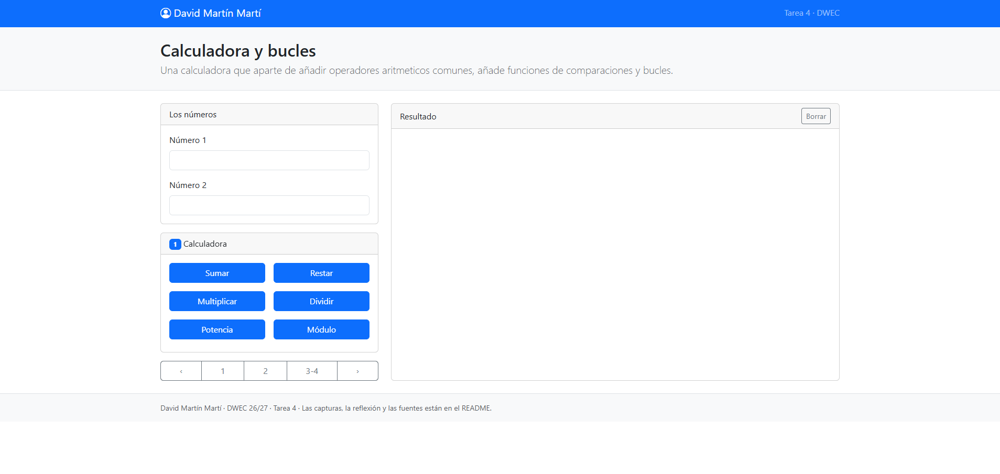
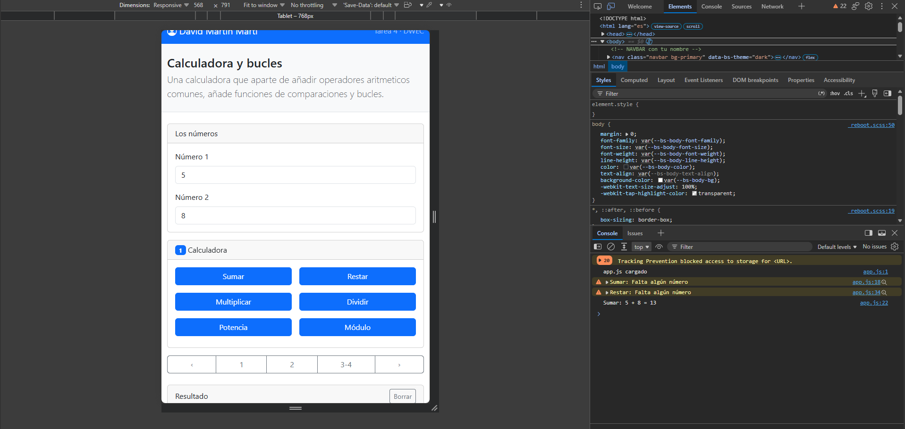
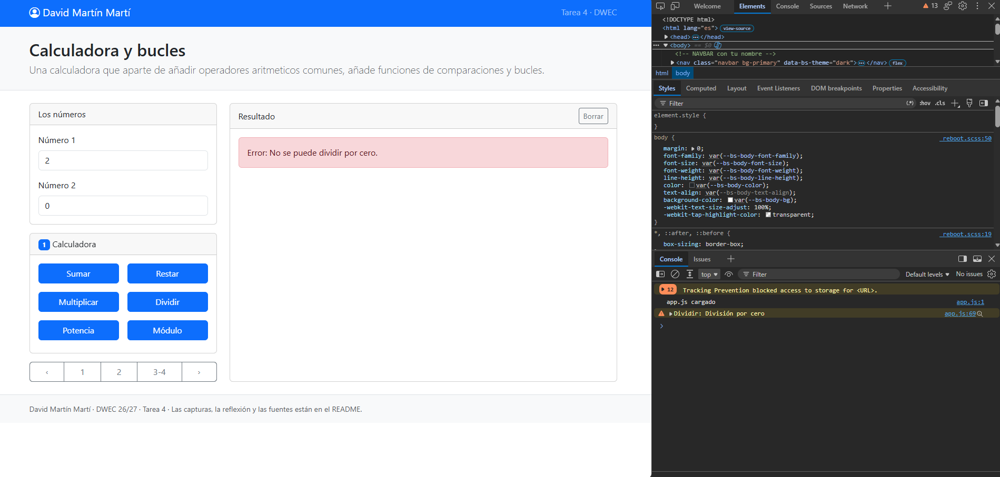
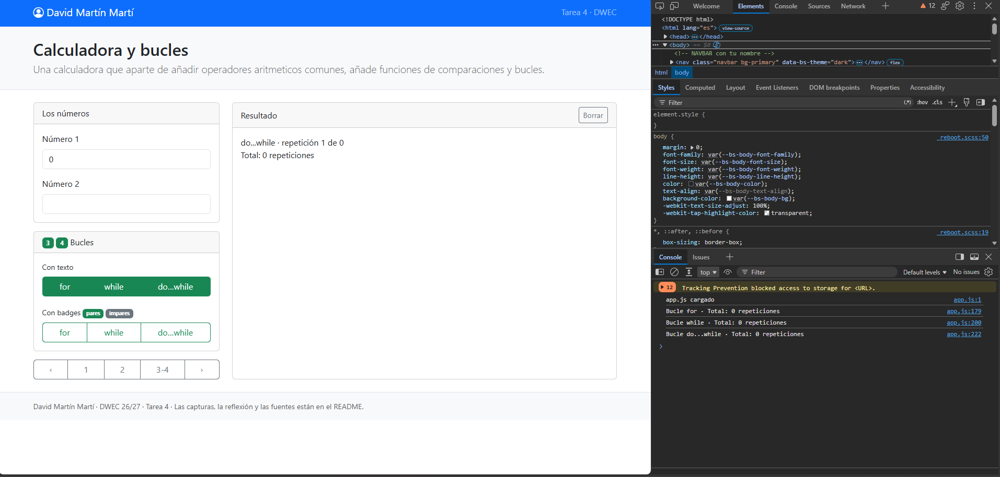
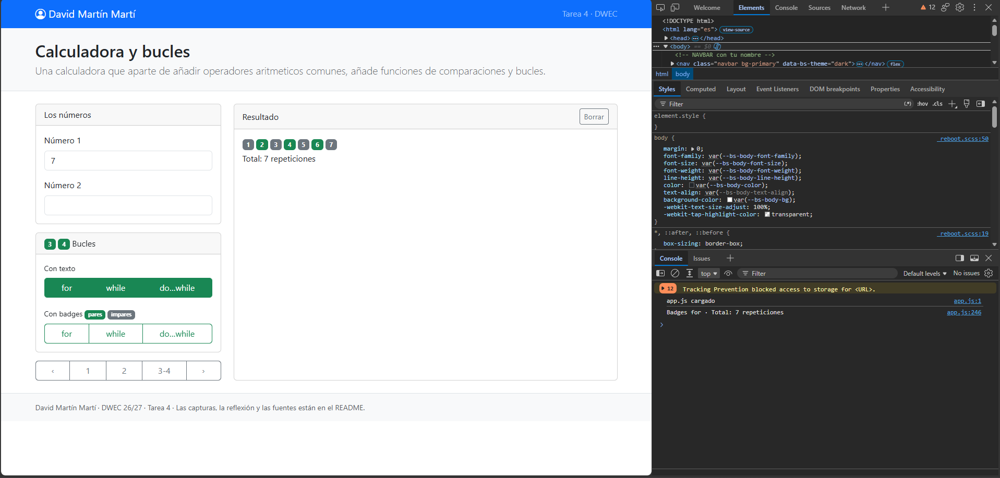

# Tarea 4 · Calculadora y bucles

**Autor:** David Martín Martí · Desarrollo Web en Entorno Cliente (DWEC) · 2.º DAW · Curso 2026-27

Página «Calculadora y bucles» hecha con Bootstrap 5 y JavaScript: dos casillas para números, una card de resultado y botones para las operaciones, las comparaciones y los bucles.

## Capturas

### a) La página entera

Captura mostrando mi nombre en el navbar. A la izquierda (un tercio) están la card de los números y el carrusel de ejercicios; a la derecha, la card de resultado.

### b) La página en el móvil

En el modo dispositivo de F12 las columnas pasan a ser una: números, carrusel y resultado quedan uno debajo de otro.

### c) El error de dividir entre 0

Con el número 2 en 0 pulso Dividir: la página muestra un aviso rojo y la consola un `warn` de división por cero, en lugar de mostrar `Infinity`.

### d) Los tres bucles con el número 0

Con el número 1 en 0, `for` y `while` no dan ninguna vuelta («Total: 0 repeticiones») y `do…while` da una («Total: 1 repetición»). Esto ocurre ya que el `do...while` siempre se ejecuta al menos una vez, dando igual la condición que lleve, mientras que `for` y `while` necesitan siempre que se cumpla su condición primero, antes de ejecutar su bloque.

### e) Un bucle con badges

Con el número 1 en 7 pulso el `for` de badges: los pares salen en verde y los impares en gris, elegidos con el ternario `contador % 2 === 0 ? "success" : "secondary"`.

## Reflexión

El `for` junta inicio, condición y avance en una línea, así que lo uso cuando sé cuántas vueltas daré. El `while` comprueba la condición antes de cada vuelta, por lo que puede no ejecutarse nunca; lo usaría cuando no sé cuántas vueltas habrá. El `do…while` ejecuta el cuerpo y comprueba después, así que siempre da al menos una vuelta; lo usaría cuando algo debe hacerse una vez como mínimo. El 0 lo demuestra: con 0 (o con un negativo), `for` y `while` dan 0 vueltas, pero `do…while` da 1, porque entra antes de comprobar `contador <= veces`.

## Fuentes

- [Bootstrap 5.3: carrusel](https://getbootstrap.com/docs/5.3/components/carousel/)

## Uso de IA

Usé Claude (Anthropic) como ayuda para plantear el carrusel de cards, ajustar las cajas a móvil, igualar la altura de las diferentes cards del carrusel, y a redactar un borrador de este README que posteriormente retoque y adapté.
