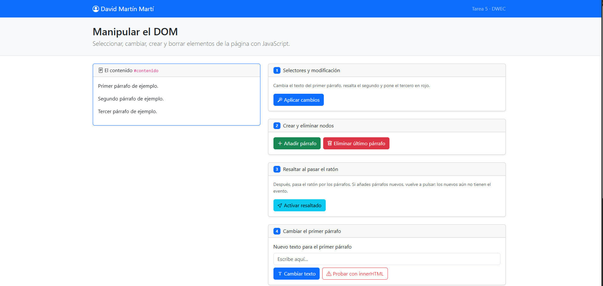
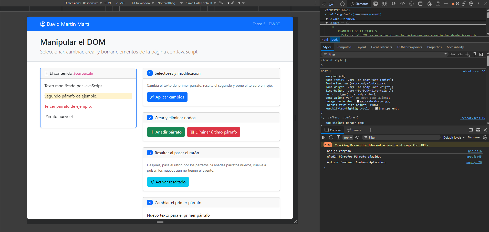
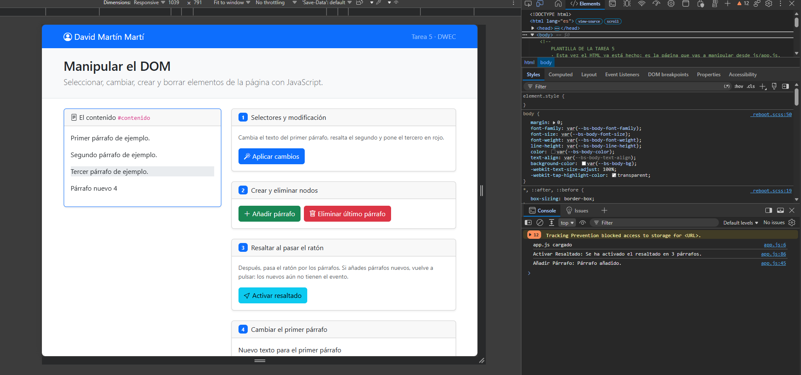
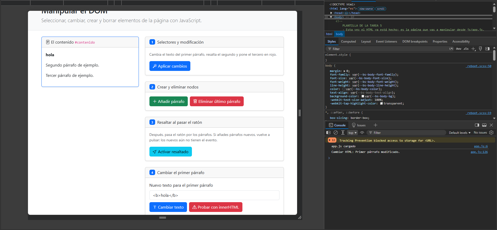
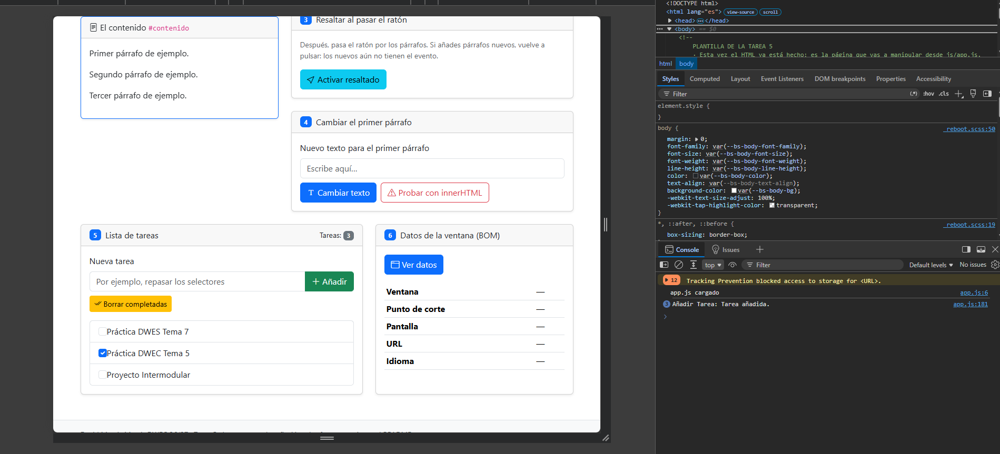
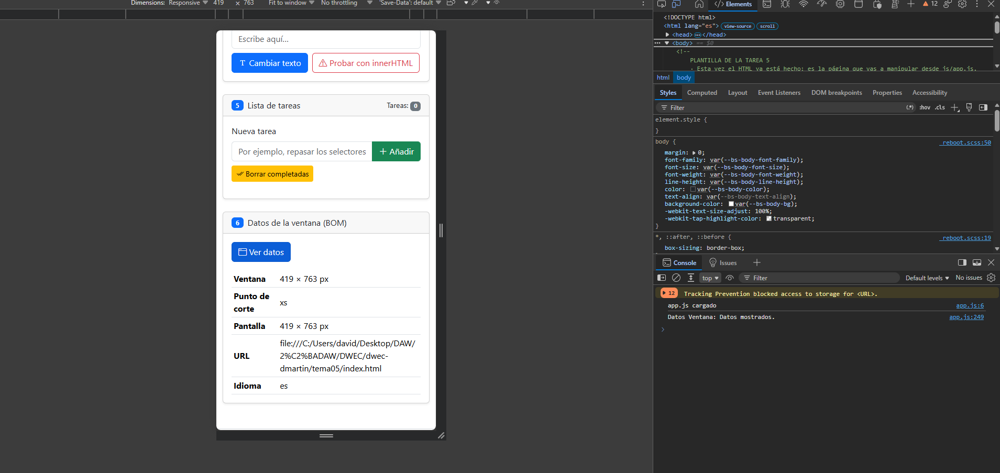

# Tarea 5 · Manipular el DOM

**Autor:** David Martín Martí · Desarrollo Web en Entorno Cliente (DWEC) · 2.º DAW · Curso 2026-27

Esta carpeta contiene la página «Manipular el DOM» con seis ejercicios, maquetada con Bootstrap, y el JavaScript que lee y cambia lo que se ve (`js/app.js`, una función por botón). Para probarla: abrir la carpeta en VS Code, pulsar **Go Live** y usar los botones con la consola abierta (F12), donde cada función deja su rastro con `console.log()`.

## Capturas

### a) La página recién cargada

Página sin tocar: mi nombre en la navbar, los tres párrafos de partida en la tarjeta «El contenido», y las diferentes cards con sus utilidades y funciones específicas de la práctica.

### b) Ejercicios 1 y 2

El primer párrafo cambia su texto (`getElementById`), el segundo se resalta con `bg-warning-subtle` (`querySelector` con `.segundo`) y el tercero se pone en rojo con `text-danger` (`querySelectorAll("#contenido p")[2]`). Debajo aparece el párrafo creado número 4.

### c) Ejercicio 3: resaltado al pasar el ratón

Tras pulsar «Activar resaltado», el párrafo bajo el ratón se ve gris (`bg-body-secondary`); al salir, la clase se quita. Los párrafos añadidos después no se resaltan hasta volver a pulsar el botón: el evento se añade solo a los párrafos que existen en el momento de pulsar, y los nuevos son elementos creados después, sin ese evento.

### d) Ejercicio 4: `<b>hola</b>` con innerHTML

Con «Cambiar texto» el párrafo muestra literalmente `<b>hola</b>`, con las etiquetas a la vista. Con «Probar con innerHTML» el navegador interpreta la etiqueta y se ve **hola** en negrita.

### e) Ejercicio 5: la lista de tareas

Tres tareas añadidas (el contador marca 3) y una casilla marcada, justo antes de pulsar «Borrar completadas», que eliminaría solo la marcada.

### f) Ejercicio 6: los datos de la ventana en el móvil

En el modo dispositivo de F12 el ancho es de unos 419 px y el punto de corte sale `xs` (menos de 576 px); en mi ordenador sale `xxl`, según el ancho de la ventana.

## Reflexión

`textContent` trata lo que recibe como texto plano: si escribo `<b>hola</b>`, en la página se ve exactamente eso, con las etiquetas. `innerHTML`, en cambio, interpreta ese texto como HTML y construye elementos, así que el mismo texto se ve como **hola** en negrita. Eso, con una etiqueta inofensiva, solo cambia el aspecto, pero demuestra que el navegador está ejecutando como código lo que ha escrito el usuario. Si en lugar de `<b>` alguien escribe una etiqueta con un script o un atributo de evento, ese código se ejecutaría en la página de otras personas (un ataque XSS) y podría robar datos o cambiar el contenido. Por eso, para meter lo que escribe el usuario (como el texto de las tareas), uso `textContent`, y reservo `innerHTML` para HTML que he escrito yo.

## Uso de IA

He usado Claude (Anthropic) para redactar un borrador de README que posteriormente he editado y adaptado yo. También lo he usado para la corrección de errores de la práctica.

He usado Gemini 3.5 Flash para resolver dudas relacionadas con el DOM: como crear un elemento, como poner atributos a elementos, como añadir o borrar clases a la lista de clases de un elemento, etc.