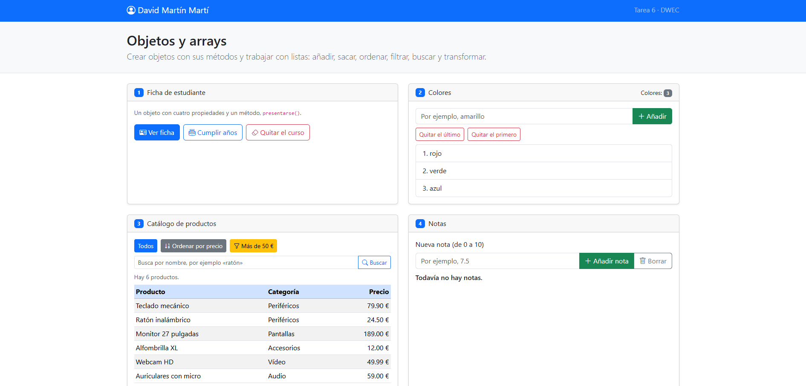
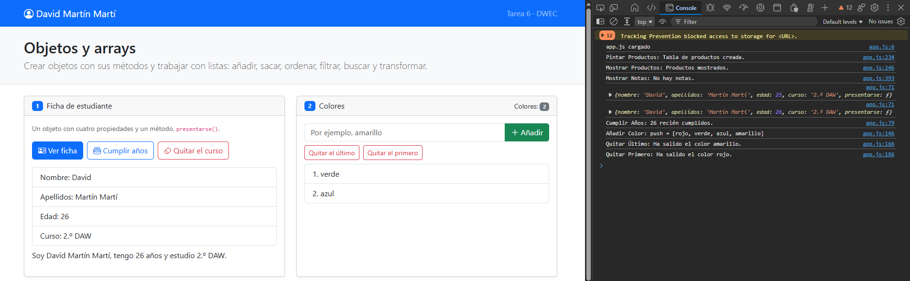
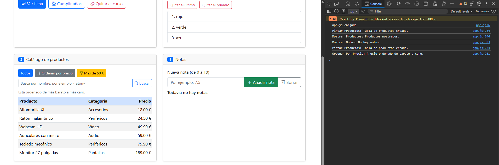
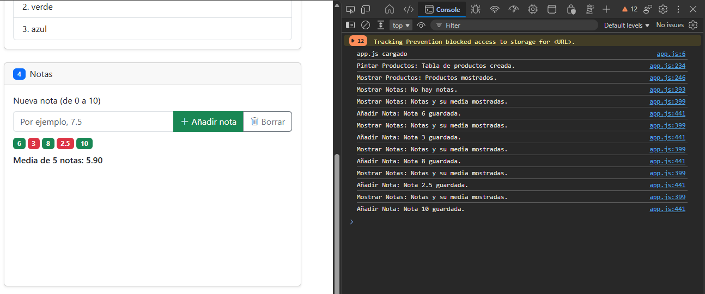
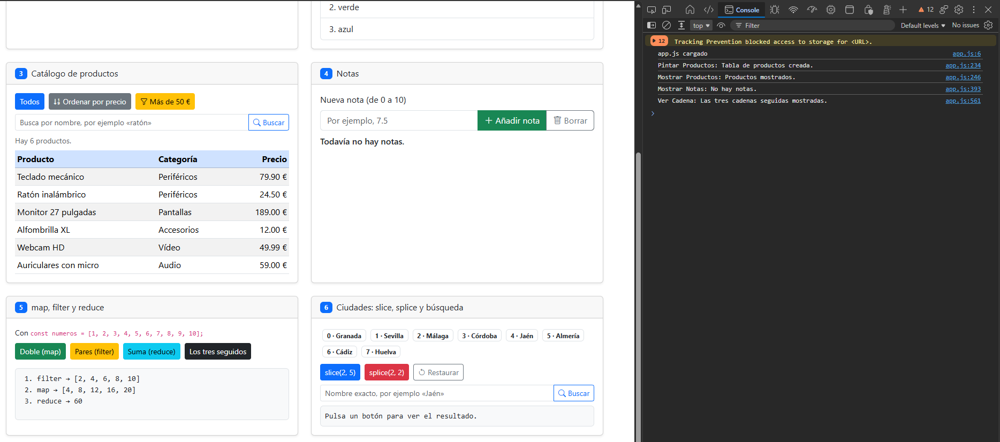
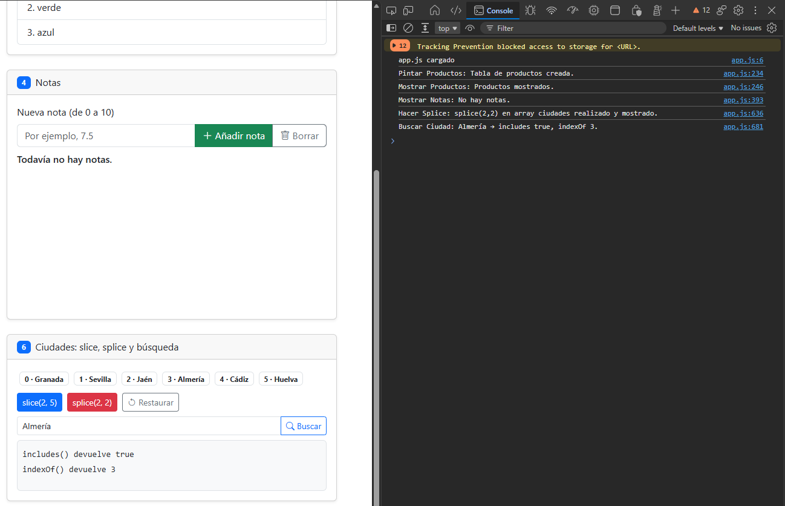

# Tarea 6 · Objetos y arrays

**Autor:** David Martín Martí · Desarrollo Web en Entorno Cliente (DWEC) · 2.º DAW · Curso 2026-27

Esta carpeta contiene la página «Objetos y arrays» con seis ejercicios (`index.html`), en los que trabajamos diferentes métodos y funcionalidades sobre los arrays y objetos, su JavaScript (`js/app.js`) con cada función usada en los ejercicios, las capturas y este `README.md`.

## Capturas

### a) La página recién cargada

Se ve mi nombre en la barra superior, los botones para añadir ficha, cumplir años y quitar curso, la lista con los tres colores de partida y su contador, la tabla con sus seis productos y el card de notas vacío con su mensaje informativo de «Todavía no hay notas.».

### b) Ejercicios 1 y 2: la ficha y los colores

La ficha se pinta recorriendo un array de claves y leyendo cada valor con `estudiante[clave]`; tras «Cumplir años» la edad sube de 25 a 26. En los colores uso `push` para añadir, `pop` para quitar el último y `shift` para quitar el primero. Tras «Quitar el curso» sale `Curso: undefined`: `delete` elimina la propiedad del objeto, así que al leer `estudiante["curso"]` ya no existe y JavaScript devuelve `undefined`. Por eso `presentarse()` también dice «estudio undefined».

### c) Ejercicio 3: el catálogo ordenado por precio

La tabla va del Alfombrilla XL (12 €) al Monitor (189 €). Uso `sort` con `function (a, b) { return a.precio - b.precio; }` sobre una copia `[...productos]`, porque `sort` cambia el array en el que se llama y no quiero perder el orden original del catálogo.

### d) Ejercicio 4: las notas y la media

Cinco notas como badges: en verde las de 5 o más y en rojo las suspensas. Debajo, la media con dos decimales, calculada con `reduce` en el método `media()` del objeto `alumno`.

### e) Ejercicio 5: los tres métodos seguidos

Primero `filter` deja los pares `[2, 4, 6, 8, 10]`, después `map` los duplica `[4, 8, 12, 16, 20]` y por último `reduce` los suma: 60.

### f) Ejercicio 6: después de splice y de buscar una ciudad

`splice(2, 2)` ha quitado Málaga y Córdoba. Almería estaba en la posición 5 y ahora está en la 3, así que `indexOf("Almería")` devuelve 2. Si busco Málaga, `includes` da `false` e `indexOf` da `-1`.

## Reflexión

Cambian el array original `push`, `pop`, `shift`, `splice` y `sort`; devuelven uno nuevo `slice`, `map` y `filter` (y `reduce` devuelve un único valor). En el ejercicio 6, `slice(2, 5)` devuelve Málaga, Córdoba y Jaén, pero `ciudades` sigue teniendo 8 elementos. En cambio `splice(2, 2)` devuelve Málaga y Córdoba y deja `ciudades` con 6, por eso Jaén cambia de posición. En el ejercicio 3 ordeno una copia porque `sort` modificaría `productos` y el botón «Todos» ya no mostraría el catálogo en su orden de partida.

## Fuentes

- Presentación del profesor del Tema 6.

## Uso de IA

He usado Claude (Anthropic) para revisar mi código contra el enunciado y la rúbrica y para preparar un borrador de este README. Después revisé cada corrección, la apliqué yo en mi código y comprobé las capturas y los resultados en mi navegador. También me recomendo el uso de la función `crearElemento()`, para reutilizar y economizar el código.
