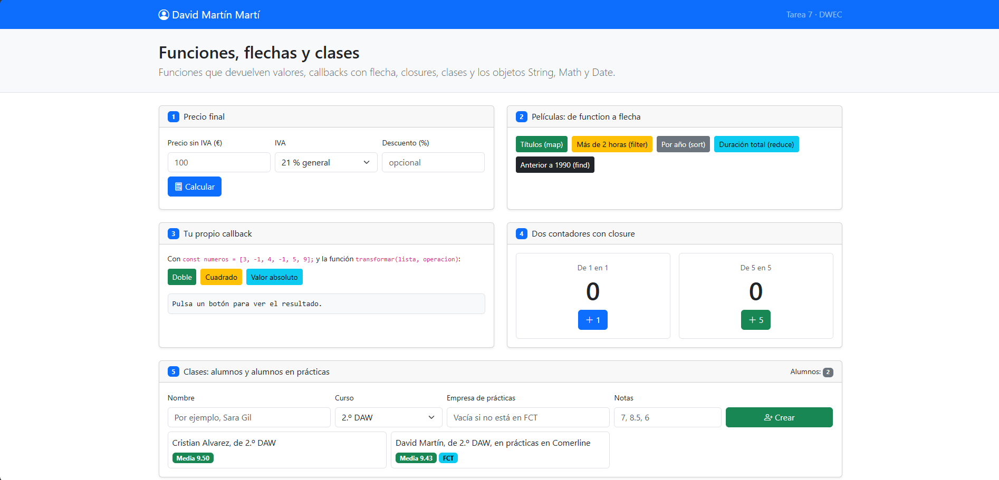
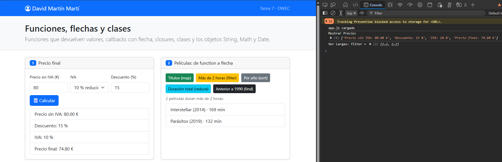
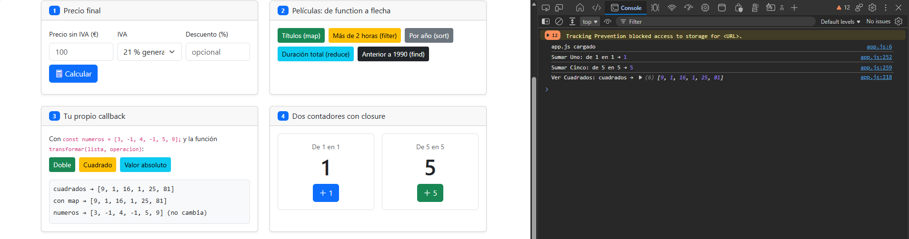
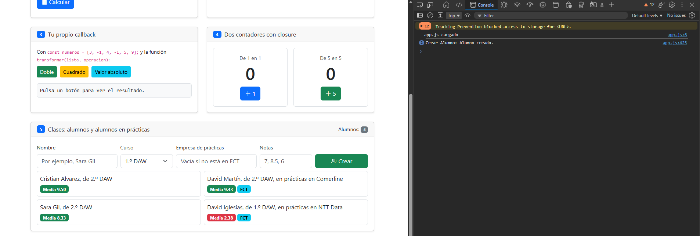

# Tarea 7 · Funciones, flechas y clases

**Autor:** David Martín Martí · Desarrollo Web en Entorno Cliente (DWEC) · 2.º DAW · Curso 2026-27

Página con seis ejercicios sobre los diferentes tipos de funciones y clases. En la carpeta de proyecto se contiene el `index.html`, este `README.md`, la carpeta de capturas y la carpeta de js con su `app.js`.

## Capturas

### a) La página recién cargada

Mi nombre en la navbar y los dos alumnos de partida: Cristian Alvarez (`Alumno`, media 9,50) y David Martín (`AlumnoFCT` en Comerline, media 9,43).

### b) Ejercicios 1 y 2: el precio y las películas

80 € con un 15 % de descuento y un 10 % de IVA dan 74,80 €. `calcularPrecio()` solo calcula y devuelve el precio, aplicando los porcentajes de IVA y descuento; `mostrarPrecio()` lee el formulario, valida y pinta el desglose. A la derecha, «Más de 2 horas» (`filter`).

### c) Ejercicios 3 y 4: tu callback y los contadores

`transformar()` recorre la lista con `for…of`, llama a `operacion` con cada elemento de la lista y guarda el resultado en un array nuevo. Cada llamada a `crearContador()` crea su propia variable `cuenta`, que solo ve la función devuelta (closure), por eso no se mezclan. Si escribo `cuenta` en la consola, da `ReferenceError`, porque solo existe dentro del closure.

### d) Ejercicio 5: los alumnos

Cuatro alumnos, dos en prácticas. Si la casilla de empresa está vacía, se crea un `Alumno`; si no, un `AlumnoFCT`.

### e) Ejercicio 6: fechas y textos

Con el 3 de mayo de 2001 sale «Fue hace 9320 días: el jueves, 3 de mayo de 2001». Redondeo con `Math.round` porque, con el cambio de hora, la resta no da días exactos. Al lado, las iniciales DMM y el usuario dmm926.

## Reflexión

Al pasar un callback de `function` a flecha se escribe menos: `function (pelicula) { return pelicula.duracion > 120; }` queda en `(pelicula) => pelicula.duracion > 120`. Si el cuerpo es una sola expresión, se quitan las llaves y el `return`, porque la flecha devuelve el valor sola. El `return` hace falta cuando hay llaves, porque el cuerpo tiene varias instrucciones. Un método no se escribe con flecha porque la flecha no tiene su propio `this`: en `media()`, `this.notas` no apuntaría al alumno.

## Fuentes

- Presentación del Tema 7

## Uso de IA

He usado Claude (Anthropic) para revisar mi código respecto al enunciado y localizar errores, que corregí yo; para resolver dudas sobre `Date` y la función `iniciales()`; para comentar `app.js`; y para un borrador de este README, que posteriormente he revisado y adaptado.